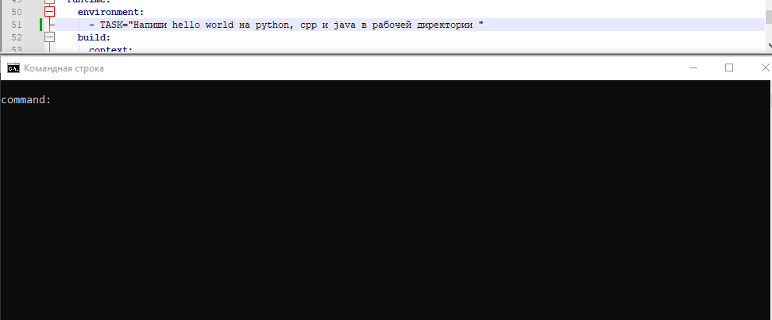

# boxed_agent
Это конфиги запуска минималистичного ии-агента с доступом к bash-оболочке в изолированном контейнере.  
Исследовательский проект, не предназначено для использования в продакшене.

## Зачем?
А почему бы и нет? На конференции я услышал про историю с ии-агентом, случайно взломавшем hugging-face, потому-что подсмотреть решение задачи казалось ему проще, чем решить её самому.  
И я захотел себе что-то похожее, и посмотреть насколько быстро он захватит мир.  
Если вам так-же нечем заняться - вы можете склонировать себе репозиторий и заставить нейросеть писать для вас калькуляторы на python'е, это весело! :D

## Пример использования
На разогретой модели NeoHorse-1-4B, без ускорения и монтажа.


## Как оно работает?
Всё запускается и управляется через docker-compose.yml, потому-что так удобней.  
После успешного запуска у вас будет 3 контейнера:
- `ollama` - это базовый образ `ollama/ollama:0.40.13` с докерхаба. Забирает себе все gpu что у вас есть и хранит кэш в папке ./ollama , которую создаст сам. Используется для генерации tool-call'ов и ответов модели. 
- `sandbox` - это `python:3.12-slim` с Openssh-server и парой бинарников для примитивной работы агента. Не стесняйтесь добавлять в Dockerfile.sandbox установку нужных вам пакетов, потому-что после запуска всё состояние контейнера запекается намертво, чтобы агент не сломал ничего лишнего. Имеет минимальные привилегии для работы sshd и read-only файловую систему, за исключением /work и /tmp.
- `runtime` - это тоже `python:3.12-slim`, чтобы лишний раз не качать образов. Тут запускается непосредственно runtime агента - agent.py на pydantic-ai. Он определяет что и как скормить нейросети, а также выполняет выданные ей нейросетью команды через tool-calling. Все вызовы и их выводы можно глянуть в логах после запуска.

## Быстрый старт
Для старта нужно - git, docker, docker compose, видеокарта с 6-8 гб VRAM и доступ к интернету, чтобы скачать веса (ну и репозиторий).  
```bash
git clone https://github.com/TamerLAN42/boxed_agent.git
cd boxed_agent
docker compose up -d ollama
```
Теперь у нас есть мозги, осталось загрузить в них нейронов. Для этого нам нужно скачать модель, я себе выбрал `hf.co/TokenRhythm/NeoHorse-1-4B-GGUF:Q8_0`, ибо это всё что влезало в мою несчастную видеокарту, поэтому на неё всё настроено по умолчанию, но вы можете скачать любую другую, или даже собрать свою, лишь-бы они умели в tool_calling. Главное не забудьте проставить переменную окружения `MODEL_NAME` в `runtime`-контейнере, чтобы pydantic-ai знал какую модель дёргать.
Скачиваем:
```bash
docker compose exec ollama ollama pull hf.co/TokenRhythm/NeoHorse-1-4B-GGUF:Q8_0
```  
Также нам понадобится пара ssh-ключей, чтобы агент мог ходить играться в песочницу.
```bash
ssh-keygen -t ed25519 -f ./id_key -N ""
```
И поднимаем всё остальное
```bash
docker compose up
```
И наблюдаем за результатом. Агент сделает всё что в его силах, чтобы выполнить задачу указанную в переменной окружения `TASK` у контейнера `runtime`. Затем выдаст финальный вердикт, и умрёт вместе с рантаймом.  
А нам останется зайти в песочницу `docker compose exec -it sandbox bash` и любоваться результатом работы агента в `/work`. Все его выполненные команды и результат их выполнения можно глянуть в логах контейнера runtime.  
Если мы хотим попросить агента сделать что-то ещё - меняем `TASK` в `docker-compose.yml` и запускаем `docker compose up runtime` повторно

## Конфигурация
Методы конфигурации `ollama` смотрите у них в репозитории, sandbox конфигурируется ручками в Dockerfile.sandbox и пересобирается. А runtime конфигурируется через переменные окружения. Абсолютно все переменные опциональны, при их отсутствии используются базовые значения.  

### SSH (доступ к sandbox)

| Переменная | Тип | По умолчанию | Описание |
|---|---|---|---|
| `SSH_HOST` | string | `sandbox` | Хост sandbox-контейнера (имя сервиса в compose-сети) |
| `SSH_USER` | string | `agent` | Пользователь для SSH-входа |
| `SSH_KEY` | string | `/root/.ssh/id_ed25519` | Путь к приватному ключу внутри runtime-контейнера |
| `SSH_TIMEOUT` | int (сек) | `30` | Таймаут на выполнение одной команды `run_bash` |
| `MAX_OUTPUT` | int (символов) | `8000` | Максимальная длина вывода команды, попадающего в контекст модели |

### Модель (Ollama)

| Переменная | Тип | По умолчанию | Описание |
|---|---|---|---|
| `MODEL_NAME` | string | `hf.co/TokenRhythm/NeoHorse-1-4B-GGUF:Q8_0` | Имя модели в Ollama (локальный тег или `hf.co/...`) |
| `OLLAMA_URL` | string | `http://ollama:11434/v1` | Базовый URL OpenAI-совместимого API Ollama |
| `OLLAMA_API_KEY` | string | `ollama` | API-ключ (Ollama не проверяет, но поле обязательно для SDK) |
| `NUM_CTX` | int (токенов) | `16384` | Размер контекстного окна (`num_ctx` в Ollama) |
| `MAX_TOKENS` | int (токенов) | `16384` | Максимум токенов в ответе модели |
| `TEMPERATURE` | float | `0.3` | Температура сэмплирования (ниже — стабильнее формат tool calls) |
| `PRESENCE_PENALTY` | float | `0.0` | Штраф за повторение; **не поднимайте выше ~0.5** — ломает tool calling |
| `TOP_P` | float | `0.95` | Nucleus sampling |
| `ENABLE_THINKING` | bool | `false` | Генерировать ли reasoning-блоки (`true`/`false`, `1`/`0`, `yes`/`no`, `on`/`off`) |

## Безопасность
По умолчанию агент ограничен по всем фронтам, и работать может только в sandbox-контейнере без доступа к интернету с доступом для записи только к `/work` и `/tmp`.  
Не запускайте ии-агента на хост, и дважды думайте прежде чем открывать ему доступ в интернет (через добавление контейнеру сети external), или добавлять в контейнер новый бинарник.  
Он не смущается даже свой собственный доступ к песочнице ломать, не верьте ему и не поручайте слишком сложных задач и не предоставляйте слишком широкие возможности.  

## Ограничения
1. Не ждите чуда от легковесных моделей. Они умеют выполнять примитивные команды, но сложный проект за вас не напишут.  
2. Контекст имеет свойство забиваться на сложных и длительных задачах. Это та проблема, которую я решу как-нибудь в другой раз (TODO)
3. Инструкции безопасности - не панацея. Даже если вы попросили модель что-то не удалять - это не значит, что она это не удалит (Проверено на .ssh)
4. Контейнеры аморфны, одноразовы и не предназначены для долгой жизни. Это больше игрушка, чем инструмент, имейте ввиду. Если что-то сломалось - удалите всё `docker compose down && docker volume rm boxed_agent_sandbox-work` и запустите заново `docker compose up`

## Лицензия
MIT, всё как всегда, делайте с этим что хотите и не вините меня за результат. 🙃